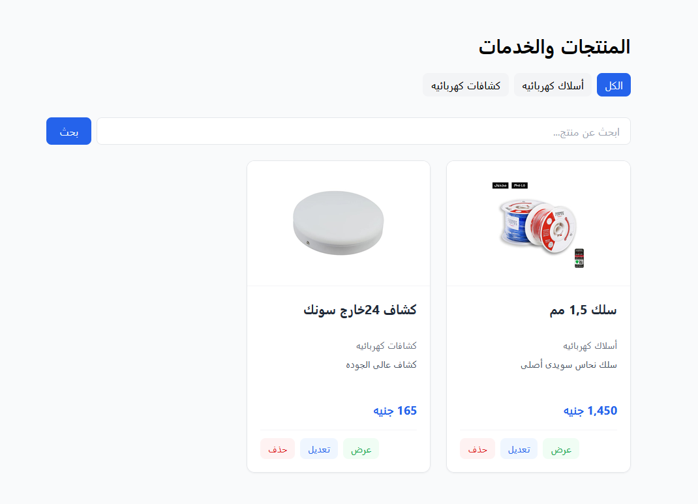
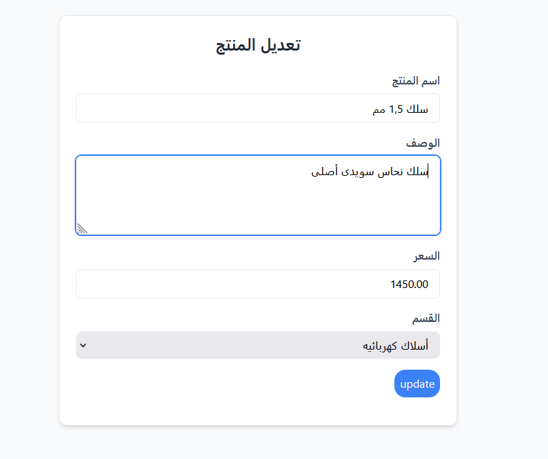

# Electric Shop — Product Management System

A product and service management app for an electrical shop, built with **Laravel**. Products are organized by category, can have images, and are displayed in a responsive card grid with search, category filtering, and pagination. The interface is in Arabic (RTL).


Add screenshots, then uncomment this block:

## Screenshots

| Products list | Edit product |
|---|---|
|  |  |


## Features

- **Full CRUD** for products: create, list, view, edit, delete
- **Categories** with a one-to-many relationship (a category has many products)
- **Image upload** for products. The old image is deleted when replaced or when the product is removed, and a placeholder is shown when there is no image
- **Search** by product name and **filter** by category. Both work together and are preserved across pages
- **Pagination** (6 products per page)
- **Server-side validation** using Form Requests, with custom Arabic error messages
- **Reusable Blade components** for the layout and validation errors
- **Responsive UI** built with Tailwind CSS
- Flash messages that auto-hide (Alpine.js)

## Built With

| | |
|---|---|
| Framework | Laravel 13 |
| Language | PHP 8.5 |
| Database | MySQL |
| Styling | Tailwind CSS |
| JavaScript | Alpine.js (flash messages only) |

## Getting Started

### Requirements

- PHP and Composer
- MySQL

### Installation

```bash
git clone https://github.com/MagdyMahmoud88/electric-crud.git
cd electric-crud

composer install
cp .env.example .env
php artisan key:generate
```

Create an empty MySQL database named `electric_crud`, then set your credentials in `.env`:

```env
DB_CONNECTION=mysql
DB_HOST=127.0.0.1
DB_PORT=3306
DB_DATABASE=electric_crud
DB_USERNAME=root
DB_PASSWORD=
```

Run the migrations, seed the categories, link the storage folder (needed to display uploaded images), and start the server:

```bash
php artisan migrate
php artisan db:seed --class=CategorySeeder
php artisan storage:link
php artisan serve
```

Open <http://127.0.0.1:8000/products>.

## Project Structure

| Path | Purpose |
|---|---|
| `app/Http/Controllers/ProductController.php` | Resource controller for products |
| `app/Http/Requests/ProductRequest.php` | Validation rules and Arabic messages |
| `app/Models/Product.php` | Model with the `inCategory` and `search` query scopes |
| `app/Models/Category.php` | Category model (`hasMany` products) |
| `resources/views/products/` | Index, create, edit, and show views |
| `resources/views/components/` | Layout and error components |

## How Search and Filtering Work

Filtering is implemented with Eloquent **query scopes** in the `Product` model. Each scope uses `when()`, so an empty filter leaves the query untouched:

```php
Product::with('category')
    ->inCategory($request->query('category'))
    ->search($request->query('search'))
    ->latest()
    ->paginate(6);
```

`with('category')` eager loads the relationship to avoid the N+1 query problem, and `appends(request()->query())` keeps the active filters in the pagination links.

## Current Limitations and Next Steps

- [ ] **No authentication yet.** Anyone with the URL can add, edit, or delete products, so do not deploy this publicly as it is
- [ ] Automated tests (Pest)
- [ ] Manage categories from the UI instead of seeding them
- [ ] Deploy a live demo

## Author

Built by [MagdyMahmoud88](https://github.com/MagdyMahmoud88)
